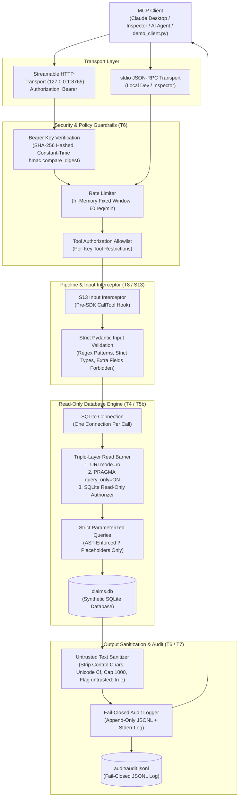
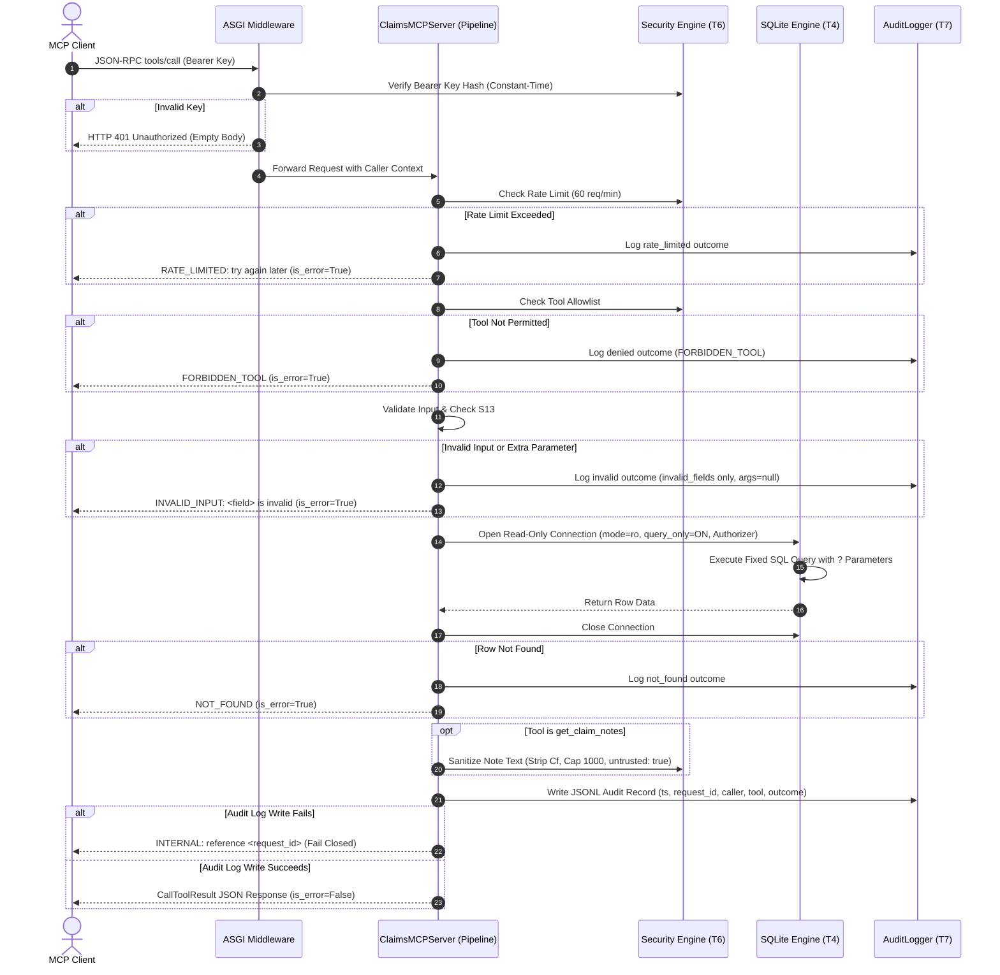

# Meridian Health Claims MCP Server

A secure, read-only Model Context Protocol (MCP) server over a synthetic health-insurance claims database.

[](https://github.com/adwitiya-pandey/claims-mcp-server/actions)
[](https://opensource.org/licenses/MIT)
[](https://www.python.org/downloads/)
[](https://github.com/modelcontextprotocol/python-sdk)

---

## What and Why (The Client Call)

Meridian Health TPA (fictional) processes approximately 3,000 health insurance claims daily across four commercial insurers and requires AI assistants to help internal teams query claims data. Compliance and security enforce an absolute rule: **no AI assistant ever receives direct SQL or direct database access**, and every interaction must leave an immutable, auditable trail. This server provides the secure Model Context Protocol (MCP) mediation layer exposing five strictly read-only, parameterized tools with defense-in-depth SQLite protection, API key authentication, per-tool authorization, rate limiting, input sanitization, and fail-closed audit logging.

---

## Quickstart

Run these three commands from a clean clone to set up dependencies, generate synthetic data and keys, and launch the server:

```bash
# 1. Install dependencies with uv
uv sync

# 2. Seed deterministic synthetic database and generate an API key
uv run python scripts/seed_db.py --out data/claims.db && uv run python scripts/make_key.py --id analyst-1 --tools all

# 3. Start the MCP server (stdio transport for inspector / local agents)
CLAIMS_DB_PATH=data/claims.db uv run python -m claims_mcp --transport stdio
```

### Running the Live HTTP Demo Client

To test the server over Streamable HTTP with API key authentication, error taxonomy demonstrations, and prompt-injection defense over all 18 seeded adversarial notes:

```bash
# Terminal 1: Launch the HTTP server on port 8765
CLAIMS_DB_PATH=data/claims.db CLAIMS_KEYS_FILE=keys.json uv run python -m claims_mcp --transport http

# Terminal 2: Run the comprehensive live demo client
uv run python scripts/demo_client.py --key <YOUR_GENERATED_RAW_KEY>
```

---

## System Architecture

### Architectural Flowchart



### Complete Sequence Diagram



---

## Annotated File Structure Tree

```
claims-mcp-server/
│
├── .dockerignore                     # Docker build exclusion rules
├── .env.example                      # Template for environment configuration
├── .gitattributes                    # Line ending LF normalizations
├── .gitignore                        # Git exclusion rules (keys, .env, DBs, logs)
├── .pre-commit-config.yaml           # Pre-commit linting and security hooks
├── .python-version                   # Pinned Python version (3.12)
├── Dockerfile                        # Multi-stage non-root container with health check
├── LICENSE                           # MIT open source license (Adwitiya Pandey)
├── PROGRESS.md                       # Task execution and milestone completion log
├── README.md                         # Enterprise documentation and operational manual
├── SPEC.md                           # Formal scope contract and requirements specification
├── TASKS.md                          # Sequential autonomous implementation task breakdown
├── THREAT_MODEL.md                   # STRIDE threat model and requirement-to-test verification matrix
├── pyproject.toml                    # Package metadata, dependencies, and test configurations
├── schema.sql                        # SQLite DDL schema contract with strict CHECK constraints
├── uv.lock                           # Deterministic cryptographic dependency lockfile
│
├── audit/
│   └── audit.jsonl                   # Append-only fail-closed structured JSONL audit trail
│
├── data/
│   ├── adversarial_note_ids.txt      # Line-delimited IDs of 18 synthetic adversarial test notes
│   └── claims.db                     # Deterministic synthetic claims SQLite database
│
├── docs/
│   ├── EXPLAIN-PLAIN-ENGLISH.md      # Plain-English guide for queries, architecture, and defenses
│   ├── decisions.md                  # Comprehensive architectural decision records (D1–D14)
│   └── mcp_sdk_notes.md              # Verified empirical probe results for MCP Python SDK v2
│
├── scripts/
│   ├── demo_client.py                # Live HTTP client testing all 5 tools and adversarial notes
│   ├── make_key.py                   # Secure CLI generating SHA-256 hashed API keys
│   ├── probe_sdk.py                  # Standalone probe verifying MCP SDK v2 capabilities
│   └── seed_db.py                    # Deterministic synthetic database seeder (Random seed 42)
│
├── src/
│   └── claims_mcp/
│       ├── __init__.py               # Package root exports
│       ├── __main__.py               # CLI entrypoint supporting --transport stdio|http
│       ├── audit.py                  # Fail-closed append-only JSONL & stderr audit logger
│       ├── config.py                 # Startup environment validation (S10)
│       ├── db.py                     # Read-only SQLite connection layer behind authorizer (S1)
│       ├── models.py                 # Pydantic input models, ID regex, and SPEC 8 error taxonomy
│       ├── queries.py                # 5 strictly parameterized SQL queries using ? placeholders
│       ├── security.py               # KeyStore, rate limiting, and untrusted text sanitization (S4-S7)
│       └── server.py                 # MCPServer pipeline, S13 interceptor, and tool registrations
│
└── tests/
    ├── __init__.py                   # Test suite package marker
    ├── fixtures.py                   # Tiny deterministic in-memory fixture database builder
    ├── test_audit.py                 # Tests verifying fail-closed audit logging and payload omission
    ├── test_config.py                # Tests verifying startup configuration refusals (S10)
    ├── test_db_readonly.py           # Tests proving write operations fail against SQLite authorizer (S1)
    ├── test_injection.py             # 40+ parameterized tests verifying hostile abuse rejection
    ├── test_queries.py               # Tests validating query outputs and AST check for ? placeholders
    ├── test_s13_server.py            # Tests verifying pre-SDK input interception and no input echo (S13)
    ├── test_security.py              # Tests verifying constant-time auth, allowlists, and sanitization
    ├── test_seed_fixture.py          # Tests verifying deterministic synthetic DB row counts and CHECKs
    ├── test_server_protocol.py       # Full protocol tests through real MCP Client (tools, errors, HTTP)
    ├── test_smoke.py                 # Basic package import smoke test
    └── test_validation.py            # Comprehensive parameter validation tables for scalars and limits
```

---

## The Five Named Tools

| Tool Name | Parameters | Description |
|---|---|---|
| `get_claim` | `claim_id: str` | Retrieves one claim joined with member plan and provider network status. |
| `list_member_claims` | `member_id: str`<br>`status: str \| None`<br>`limit: int = 20`<br>`offset: int = 0` | Lists claims for a member ordered newest first (`service_date DESC, claim_id DESC`). Returns `NOT_FOUND` if member does not exist. |
| `get_coverage_rule` | `plan_id: str`<br>`procedure_code: str` | Checks coverage status, pre-authorization requirement, and maximum allowable fee. |
| `get_member_ytd_summary` | `member_id: str`<br>`year: int` | Computes year-to-date claim counts, billed/paid totals by status, and remaining plan annual limit. |
| `get_claim_notes` | `claim_id: str`<br>`limit: int = 10` | Returns untrusted notes newest first. Text is stripped of control/bidi characters, capped at 1,000 characters, and flagged `untrusted: true`. |

---

## Security Guarantees & Verification

| Requirement | Defense Implementation | Verification Test File |
|---|---|---|
| **S1: Read-Only Database** | Opened with URI `mode=ro`, `PRAGMA query_only=ON`, and an authorizer denying `INSERT`, `UPDATE`, `DELETE`, `ATTACH`, and `PRAGMA`. | `tests/test_db_readonly.py` |
| **S2/S3: Zero Dynamic SQL** | All queries in `queries.py` use strictly parameterized `?` placeholders. Validated via AST scanner. | `tests/test_queries.py`<br>`tests/test_validation.py` |
| **S4: Hashed Bearer Auth** | HTTP transport enforces Bearer keys stored as SHA-256 hashes and compared in constant time with `hmac.compare_digest`. | `tests/test_security.py`<br>`tests/test_server_protocol.py` |
| **S5: Tool Allowlists** | Per-key `allowed_tools` allowlists enforced before query execution. Unauthorized calls return `FORBIDDEN_TOOL`. | `tests/test_security.py`<br>`tests/test_server_protocol.py` |
| **S6: Rate Limiting** | In-memory fixed window rate limiter (default 60 req/min) with injectable monotonic clock. | `tests/test_security.py`<br>`tests/test_injection.py` |
| **S7: Note Sanitization** | Removes ASCII control characters (except `\n`, `\t`) and Unicode category `Cf` characters. Capped at 1,000 chars. | `tests/test_security.py`<br>`tests/test_injection.py` |
| **S8: Safe Error Taxonomy** | Structured error codes (`RATE_LIMITED`, `FORBIDDEN_TOOL`, `INVALID_INPUT`, `NOT_FOUND`, `INTERNAL`) never leak internals or echo raw input. | `tests/test_server_protocol.py`<br>`tests/test_injection.py` |
| **S9: Fail-Closed Audit** | Every call writes one JSONL record. If the audit log fails to write, query data is suppressed and `INTERNAL` is returned. | `tests/test_audit.py` |
| **S10: Startup Validation** | Server refuses to start on missing SQLite database or unconfigured/empty API keys file in HTTP mode. | `tests/test_config.py` |
| **S13: Pre-SDK Interception** | Intercepts requests before SDK argument parsing, preventing raw attacker payloads from echoing in error responses. | `tests/test_s13_server.py`<br>`tests/test_server_protocol.py` |

Full STRIDE threat model, trust boundary maps, and residual risk analyses are detailed in [THREAT_MODEL.md](THREAT_MODEL.md).

---

## Documented Limitations (SPEC 15)

1. **Prompt Injection Boundary**: Sanitizing text and setting `"untrusted": true` informs consuming AI agents that data is untrusted, but cannot mathematically prevent an LLM from obeying prompt injection. Complete mitigation relies on architectural isolation: read-only database connections, absence of write tools, and human review gates.
2. **Localhost Transport**: The HTTP server binds `127.0.0.1` and provides no native TLS termination; an external reverse proxy (Nginx, Envoy, or Caddy) must terminate TLS in production.
3. **Single-Process Rate Limiter**: Rate limits are tracked in memory per process; clustered deployments require external state backends (e.g. Redis).
4. **Key Management**: API key creation and revocation are file-based (`keys.json`).
5. **Audit Tamper-Resistance**: Audit records are stored as append-only JSONL files without cryptographic forward secrecy.
